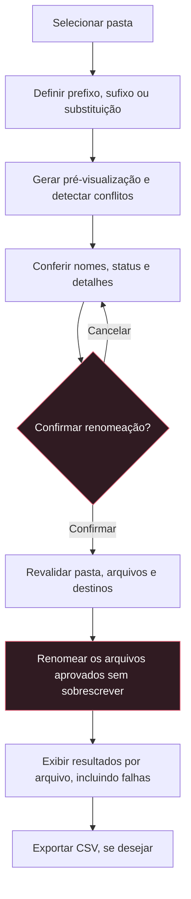
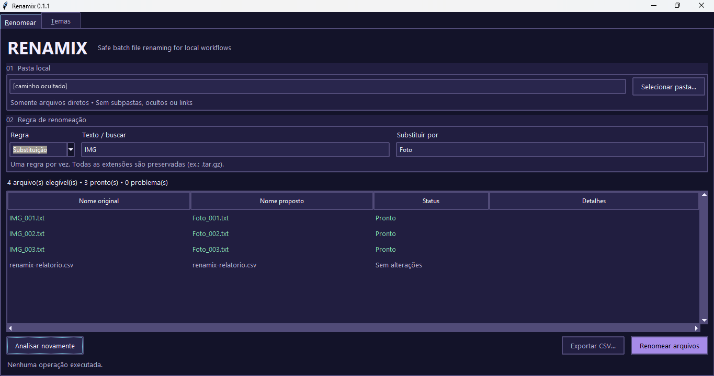
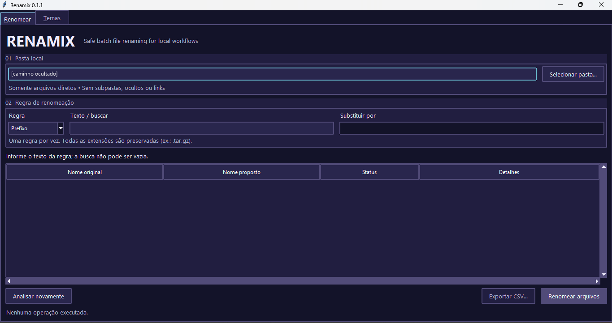
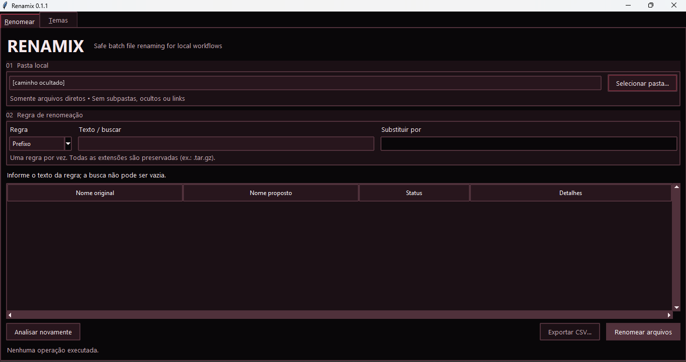
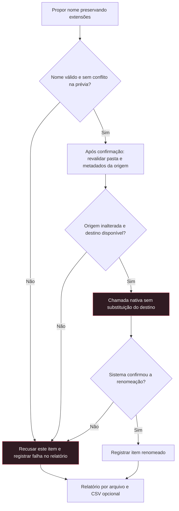

# Renamix

**Safe batch file renaming for local workflows**

Renomeie arquivos em lote com prévia, confirmação e proteção contra sobrescrita.
Aplicativo desktop com interface em **PT-BR**, **oito temas** e uso **offline**.

Versão do código: **0.1.1** · Python 3.11+ · MIT

[Windows portátil](#download-para-windows) · [Como usar](#como-usar) · [Desenvolvimento](#desenvolvimento) · [Contribuindo](#contribuindo)

## O que é o Renamix?

Uma ferramenta local para organizar documentos, ajustar nomes de fotos ou identificar
arquivos finais. Escolha uma pasta, aplique uma regra e confira cada nome antes de
confirmar. O conteúdo dos arquivos permanece intacto.

O mesmo aplicativo pode ser executado pelo código-fonte ou pelo **Renamix.exe portátil
para Windows**. Consulte a [página de releases](https://github.com/amzsants/renamix/releases)
para verificar as versões e os downloads disponíveis. Não há contas, telemetria ou
serviços externos durante o uso.

## Como funciona

A prévia apenas lê a pasta. A escrita acontece depois da confirmação, com uma nova
validação dos arquivos e destinos.



Conflitos não impedem que outros arquivos elegíveis do lote sejam executados.
Itens em conflito ou inválidos aparecem como falhas no relatório. O lote pode ter
sucesso parcial; confira os resultados antes de iniciar outra operação.

## Principais recursos

| Recurso | Na prática |
| --- | --- |
| **Prefixo** | Adicione texto antes do nome: `foto.jpg` → `viagem_foto.jpg`. |
| **Sufixo** | Adicione texto antes das extensões: `backup.tar.gz` → `backup_final.tar.gz`. |
| **Substituição** | Troque texto literal: `IMG_001.jpg` → `Foto_001.jpg`. |
| **Pré-visualização** | Confira nomes originais, propostas e status antes de escrever. |
| **Conflitos** | Detecte destinos ocupados e colisões por caixa ou normalização Unicode. |
| **CSV** | Exporte resultados e falhas para um relatório novo, sem sobrescrita. |
| **Oito temas** | Troque a aparência e restaure a preferência na próxima abertura. |
| **Interface PT-BR** | Use controles, confirmações e mensagens em português brasileiro. |
| **Windows portátil** | Execute sem instalar Python; confira os downloads na página de releases. |

Uma regra por operação. Somente arquivos regulares diretamente na pasta são elegíveis.
Subpastas, links, pontos de nova análise do Windows e ocultos são exibidos como
ignorados; também entram na contagem de analisados.

## Screenshots

A aparência padrão combina fundo escuro, painéis discretos e destaque vermelho na
ação de renomear. A interface foi validada manualmente no Windows pelo autor,
incluindo os temas Dark Beach e Vampire.

Capturas reais do **Renamix 0.1.1 no Windows**. Somente o caminho pessoal foi
ocultado para preservar a privacidade; os demais elementos foram mantidos.
Clique em uma imagem para abrir em tamanho original.

<p align="center">
  <a href="docs/assets/screenshots/main-window.png">
    
  </a>
</p>

**Pré-visualização.** Três propostas de renomeação prontas e um relatório CSV sem
alterações. A captura mostra a conferência dos nomes antes da confirmação.

<details>
<summary>Ver os temas Dark Beach e Vampire</summary>

<p align="center">
  <a href="docs/assets/screenshots/dark-beach.png">
    
  </a>
</p>

**Dark Beach.** Aparência em azul escuro e lilás, antes de preencher a regra.

<p align="center">
  <a href="docs/assets/screenshots/vampire.png">
    
  </a>
</p>

**Vampire.** Aparência em preto e vinho, antes de preencher a regra.

</details>

Ainda faltam capturas da **aba Temas** e de um **conflito detectado**. Veja o
[guia de capturas](docs/assets/screenshots/README.md). Fontes, diálogos e escala
podem variar entre sistemas.

## Temas

Na aba **Temas**, escolha uma das oito paletas: **Renamix Original**, **ChatGPT Dark**,
**ChatGPT Light**, **Codex Dark**, **Codex Light**, **Sakura**, **Dark Beach** e **Vampire**.
As amostras mostram as cores; a escolha atual aparece no rodapé. Para voltar à aparência
padrão, use **Restaurar tema original**. Mouse e teclado funcionam nos controles;
`Ctrl+Tab` alterna entre **Renomear** e **Temas**.

A mudança é imediata e preserva pasta, regra, prévia e relatório da sessão. A preferência
é restaurada na próxima abertura e fica em um pequeno `settings.json` no diretório
de configurações do usuário: `%APPDATA%\Renamix` no Windows, `~/Library/Application Support/Renamix`
no macOS e `${XDG_CONFIG_HOME:-~/.config}/renamix` no Linux. Configurações ausentes ou
inválidas recuperam o tema original; se não houver permissão para salvar, o tema continua
ativo apenas na sessão, com aviso na aba. Esse caminho não é derivado da pasta escolhida
para renomear; evite selecionar o próprio diretório de configurações como pasta de trabalho.
Tudo funciona offline.

Os temas ChatGPT e Codex são interpretações cromáticas, sem vínculo oficial com os
produtos. Dark Beach usa apenas cores originais inspiradas em uma atmosfera noturna;
não inclui capas, imagens ou logotipos. Seletores de arquivo, mensagens e a barra de
título podem seguir o tema do sistema operacional.

## Download para Windows

Consulte as [releases do projeto](https://github.com/amzsants/renamix/releases) para
verificar quais versões oferecem `Renamix.exe`, checksum SHA-256 e licença.
O empacotamento portátil está incluído no código a partir da versão 0.1.1;
a disponibilidade dos binários depende dos ativos de cada release.

Builds de revisão também podem ser obtidos nos artefatos de execuções concluídas
do workflow **Build Windows portable**. Extraia o download e abra `Renamix.exe`:
não é necessário instalar Python, executar como administrador ou instalar o aplicativo.
Mantenha a licença junto à cópia
distribuída. Windows 10/11 x64 são os alvos, sujeitos à validação descrita abaixo.

As preferências continuam em `%APPDATA%\Renamix\settings.json`, e não ao lado do EXE.
O modo onefile extrai bibliotecas em uma pasta temporária ao iniciar; isso pode causar
uma pequena demora. Não requer rede durante o uso. O EXE não tem assinatura
digital e pode gerar avisos do SmartScreen ou antivírus. Não desative proteções;
confira a origem e o checksum e interrompa o uso se houver dúvida. Não há garantia
de ausência de falsos positivos.

Para verificar o SHA-256, compare com o arquivo `Renamix.exe.sha256` do mesmo build:

```powershell
Get-FileHash .\Renamix.exe -Algorithm SHA256
Get-Content .\Renamix.exe.sha256
```

Isso verifica integridade, sem substituir a verificação da origem do download.
Veja [como construir e validar](docs/WINDOWS.md). Quem preferir pode continuar
executando pelo código-fonte, conforme a seção Desenvolvimento.

## Como usar

1. Clique em **Selecionar pasta…** ou informe o caminho.
2. Escolha **Prefixo**, **Sufixo** ou **Substituição** e preencha o texto.
3. Confira o nome proposto, o status e os detalhes de cada entrada.
4. Use **Analisar novamente** se a pasta tiver mudado.
5. Clique em **Renomear arquivos** e confirme a quantidade e a pasta.
6. Confira o relatório e, se desejar, escolha **Exportar CSV…** usando um nome novo.

O botão de renomear só fica disponível com uma prévia válida e pelo menos um arquivo
pronto. Arquivos em conflito ou inválidos não são executados e aparecem como falhas
no relatório; os demais podem ser renomeados. Não há atomicidade do lote nem desfazer
automático. Após a operação, uma nova prévia é necessária para executar outro lote.

| Status da prévia | Significado |
| --- | --- |
| Pronto | Operação elegível; será revalidada antes de executar. |
| Sem alterações | A regra manteve o nome. |
| Ignorado | Entrada oculta, link, subpasta ou outro tipo não regular. |
| Conflito | Destino ocupado, equivalente ou compartilhado por propostas. |
| Inválido | Nome não permitido ou erro de leitura. |

### Exemplos

| Regra | Entrada | Parâmetro | Resultado |
| --- | --- | --- | --- |
| Prefixo | `documento.pdf` | `2026_` | `2026_documento.pdf` |
| Sufixo | `relatorio.xlsx` | `_final` | `relatorio_final.xlsx` |
| Substituição | `IMG_001.jpg` | `IMG_` → `Foto_` | `Foto_001.jpg` |
| Sufixo | `backup.tar.gz` | `_novo` | `backup_novo.tar.gz` |
| Prefixo | `anotações` | `projeto_` | `projeto_anotações` |

Tudo a partir do primeiro ponto que inicia uma extensão é preservado: `relatorio.v1.csv`
recebe o sufixo como `relatorio_final.v1.csv`. A substituição é literal, distingue
maiúsculas/minúsculas e atua apenas na parte anterior às extensões. Todas as ocorrências
são substituídas. Busca vazia é inválida; substituição por texto vazio é permitida,
desde que o nome final seja válido. Nomes que começam por ponto são ignorados.

O CSV usa UTF-8 com BOM e ponto e vírgula, com as colunas **Nome anterior**,
**Nome proposto**, **Resultado** e **Mensagem de erro**. Valores que poderiam ser
interpretados como fórmulas por planilhas recebem um apóstrofo inicial na exportação.

## Fluxo de segurança

Cada arquivo passa por validações antes da chamada nativa. A regra altera a parte
anterior às extensões; por exemplo, `backup.tar.gz` mantém `.tar.gz`.



O fluxo representa itens candidatos à renomeação. Entradas ignoradas ou sem alterações
não chegam à chamada nativa. Uma falha é registrada e os demais itens continuam.
A proteção contra sobrescrita não torna o lote uma transação: não há rollback.

<details>
<summary>Operações nativas e garantias por plataforma</summary>

O aplicativo não altera o conteúdo dos arquivos, não executa comandos derivados de
nomes e não cria destinos fora da pasta. A prévia apenas lista entradas e metadados.
Nenhum nome existente é liberado para outro arquivo no mesmo lote: trocas, ciclos e
cadeias que dependam de desocupar destinos são recusados.

Uma verificação de existência seguida de `Path.rename()` seria insuficiente em sistemas
que substituem o destino. Por isso, a execução usa uma chamada nativa que recusa substituir o destino:

| Plataforma | Operação sem substituição |
| --- | --- |
| Windows | `MoveFileExW` com flags zero, sem `MOVEFILE_REPLACE_EXISTING`. |
| Linux | `renameat2` com `RENAME_NOREPLACE`, usando descritor da pasta. |
| macOS | `renamex_np` com `RENAME_EXCL`. |

Se a API, kernel ou sistema de arquivos não suportar a operação, a renomeação falha.
Não há fallback para substituição, cópia/exclusão ou uma transação por links.
Referências: [Microsoft](https://learn.microsoft.com/pt-br/windows/win32/api/winbase/nf-winbase-movefileexw),
[manual Linux](https://man7.org/linux/man-pages/man2/rename.2.html) e
[Apple](https://developer.apple.com/documentation/foundation/urlresourcekey/volumesupportsexclusiverenamingkey).

</details>

## Limitações conhecidas

- A proteção nativa impede sobrescrita se outro processo criar o destino exato
  entre a validação e a chamada de renomeação. Colisões por caixa e Unicode são
  verificadas de forma conservadora na prévia e imediatamente antes da chamada;
  em volumes sensíveis a caixa, não há trava global contra a criação concorrente
  de outro nome apenas equivalente.
- As verificações de origem detectam mudanças observáveis entre prévia e execução.
  Não são uma trava contra processos hostis que troquem a origem ou a pasta no
  intervalo final antes da chamada nativa. Use pastas locais sob seu controle e
  suspenda outros organizadores/sincronizadores durante o lote. Não use como
  fronteira de segurança em pastas controladas por outros usuários.
- Não há garantia de atomicidade global, rollback ou persistência contra quedas de
  energia. Uma falha pode deixar parte do lote concluída; o relatório mostra isso.
- Nomes reservados do Windows, separadores, controles, nomes finais ocultos e pontos
  ou espaços finais são recusados em todos os sistemas. Renomeações que mudem apenas
  caixa ou forma Unicode também são recusadas, mesmo se o volume as permitir.
- Há um limite conservador de 255 bytes UTF-8 e 255 unidades UTF-16 por nome. No
  Windows, caminhos de destino com 260 ou mais unidades UTF-16 são bloqueados.
  Limites menores do volume e permissões são reportados pelo sistema operacional.
- Arquivos bloqueados podem falhar no Windows. No POSIX, arquivos abertos podem ser
  renomeados. Diretórios de rede, FUSE e volumes sincronizados exigem validação
  específica; prefira sistemas de arquivos locais com semântica nativa.
- Identidade e datas não equivalem a um hash de conteúdo. Uma alteração que preserve
  todos os metadados pode não ser detectada. O Renamix não lê o conteúdo para planejar.
- A listagem e a execução rodam em uma thread de trabalho; a inserção da tabela ocorre
  na interface. Pastas com dezenas de milhares de entradas podem ter atualização lenta.
- Não há recursão, monitoramento, instaladores, perfis, plugins ou desfazer automático.

## Estrutura do projeto

```text
renamix/
├── renamix/
│   ├── __init__.py              # versão do aplicativo
│   ├── __main__.py              # inicialização e erros de abertura
│   ├── gui.py                   # interface e eventos
│   ├── planner.py               # regras, validação e prévia sem escrita
│   ├── executor.py              # revalidação, renomeação nativa e CSV
│   └── themes.py                # oito paletas e preferência local
├── tests/                      # regras, segurança, temas e inicialização
├── packaging/windows_launcher.py
├── scripts/build_windows.py    # EXE portátil e checksum
├── requirements-build.txt      # ferramentas de build com versões fixadas
├── .github/workflows/
│   ├── tests.yml               # testes em Windows, Ubuntu e macOS
│   └── build-windows.yml       # build Windows iniciado manualmente
├── docs/
│   ├── WINDOWS.md              # construção e validação do executável
│   ├── VALIDATION.md            # registro da auditoria anterior
│   └── assets/screenshots/     # capturas reais e guia de contribuição
├── CONTRIBUTING.md
├── LICENSE
├── README.md
└── pyproject.toml
```

`gui.py` apresenta o planejamento de `planner.py` e envia o plano confirmado a
`executor.py`. Os temas ficam em `themes.py`; o núcleo usa apenas a biblioteca padrão.
Essa separação permite testar regras e proteções sem abrir a interface.

O launcher e o script de build empacotam esse mesmo aplicativo em `Renamix.exe`,
incluindo Python e Tcl/Tk. PyInstaller é uma ferramenta de build, não uma dependência
para quem recebe o executável. As saídas em `build/` e `dist/` não são versionadas.

## Desenvolvimento

### Executar e instalar

Na raiz de uma cópia do repositório, execute sem instalar pacotes externos:

```console
python --version
python -m renamix
```

Use Python 3.11 ou superior com Tkinter. Dependendo do sistema, o comando pode ser
`python3`. No Windows, a instalação oficial do Python oferece o componente Tcl/Tk.
No Ubuntu/Debian, o suporte gráfico normalmente é instalado com:

```console
sudo apt install python3-tk
```

No macOS, use uma distribuição de Python que inclua Tcl/Tk (por exemplo, o instalador
do python.org). É necessário estar em uma sessão gráfica; a interface não abre em
servidores sem display. Para diagnosticar a instalação do Tkinter:

```console
python -m tkinter
```

Para instalar o projeto em um ambiente virtual no Windows, sem precisar ativá-lo:

```console
python -m venv .venv
.venv\Scripts\python -m pip install .
.venv\Scripts\python -m renamix
```

No Linux/macOS:

```console
python3 -m venv .venv
.venv/bin/python -m pip install .
.venv/bin/python -m renamix
```

A instalação usa setuptools como ferramenta de empacotamento e pode precisar de acesso
ao índice de pacotes para obtê-lo. O aplicativo instalado não tem dependências de
execução externas e funciona sem rede. Com o ambiente ativado, `renamix` também abre
a interface. Não há argumentos de linha de comando para executar renomeações.

### Testar

Na raiz do projeto:

```console
python -m compileall -q renamix tests
python -m unittest discover -s tests -v
```

Os testes usam `tempfile` e não alteram arquivos pessoais. Cobrem as três regras,
extensões, Unicode, ignorados, conflitos, nomes inválidos, alterações após a prévia,
falhas parciais, CSV e ausência de sobrescrita. A condição de corrida do destino é
simulada criando o arquivo imediatamente antes da chamada nativa real.
Os dois testes de links só são ignorados no Windows quando a criação retorna erro
1314 (privilégio ausente); outros erros fazem o teste falhar. O teste de FIFO é
exclusivo de POSIX. Ignorados não são contabilizados como aprovados.

O workflow de testes está configurado para executar a suíte sem interface em Ubuntu,
Windows e macOS com Python 3.11, além de conferir sintaxe e instalação. Consulte o
[GitHub Actions](https://github.com/amzsants/renamix/actions) para os resultados de cada execução.

Consulte [o registro de validação local](docs/VALIDATION.md) para resultados reais
e verificações manuais ainda pendentes.

Antes de publicar, confira manualmente seleção de pasta, confirmação/cancelamento,
rolagem, escala de tela, acentos, exportação e mensagens de arquivos bloqueados nas
plataformas de distribuição. O diálogo de arquivo é nativo e pode usar outro tema.

## Contribuindo

Correções, melhorias de documentação e relatos reproduzíveis são bem-vindos.
Veja [CONTRIBUTING.md](CONTRIBUTING.md) para configurar o ambiente e propor mudanças.
Prefira melhorias pequenas, com comportamento reproduzível e testes para regras ou
garantias de arquivos. Não é necessário adicionar dependências para contribuir.

## Licença

[MIT](LICENSE) · Copyright © 2026 [Amoz Santos](https://github.com/amzsants).
